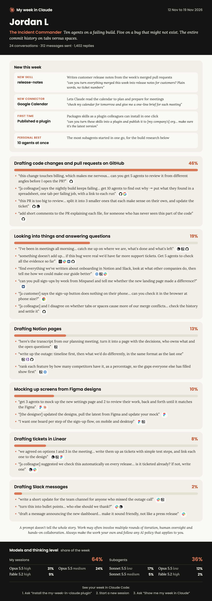
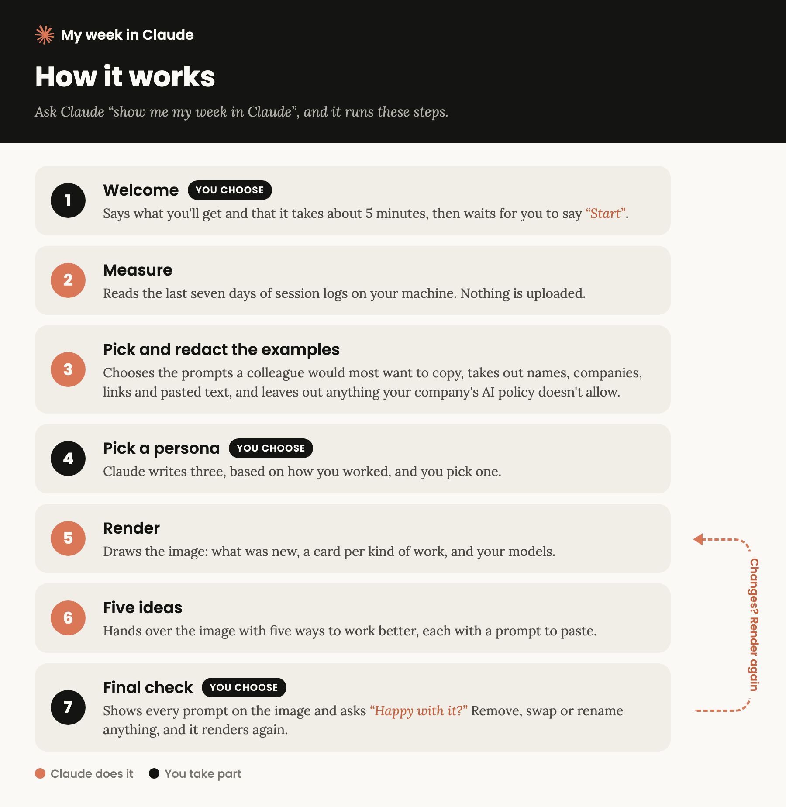

# My week in Claude

Spotify Wrapped for Claude. Your week as a shareable image and PDF, with real prompts from each kind of work, anonymised and cleaned of anything private.



## Install

In Claude Code, in a terminal or the desktop app's Code tab, ask Claude:

> Install the my-week-in-claude plugin from github.com/codebycarlos/my-week-in-claude and show me my week in Claude

Or run the commands yourself:

```sh
claude plugin marketplace add codebycarlos/my-week-in-claude
claude plugin install my-week-in-claude@my-week-in-claude
```

It doesn't run in Cowork or in a chat on claude.ai, since only Claude Code can read your session
logs. Your Cowork work still counts.

## Use

In Claude Code, ask for "my week in Claude". It checks with you before it starts, and a run takes
5 to 15 minutes.

## Updates

In Claude Code, turn on auto-update under `/plugin`, then Marketplaces, or ask Claude to update
the my-week-in-claude plugin.

## What you get

- **An image and a PDF.** Both are saved in a new folder in `Downloads/my-week-in-claude`. The image shows
  up in a post or a message; in the PDF, readers can select and copy your prompts.
- **A persona.** Claude writes three, based on how you worked, and you pick one.
- **New this week.** Skills, connectors and features you used for the first time.
- **A card per kind of work.** Its share of the week, the apps it touched, and your own prompts,
  most reusable first.
- **Models and thinking level.** Your share of each, in your sessions and in subagents.
- **Five ideas.** Claude also suggests five ways to work better, based on your week:
  a skill for something you keep repeating, a connector you have but don't use, and so on.
- **A final check.** Claude shows every prompt it is about to share and asks whether you're happy with it.
  Take out a prompt you'd rather not share, swap one or rename a card, and it draws both again.

## How it works



## Privacy

Nothing is uploaded or posted anywhere.

- **What Claude reads:** the Claude Code session logs on your machine, Cowork's included. It also
  searches the document apps it can reach, such as Notion or Google Drive, for any AI policy that
  applies to you.
- **What Claude redacts:** colleagues' names become roles, company and product names become
  `[my company]` and `[our app]`, and pasted text, links and keys come out. Your name shows as first
  name and initial.
- **What you check:** you review the image and the PDF before they go anywhere.


## Licence

MIT
